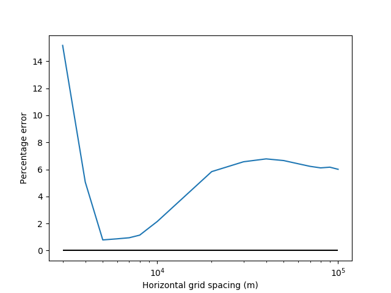
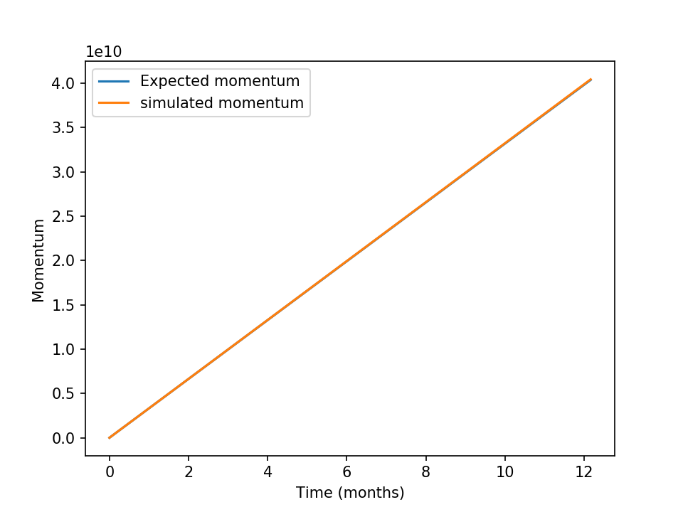
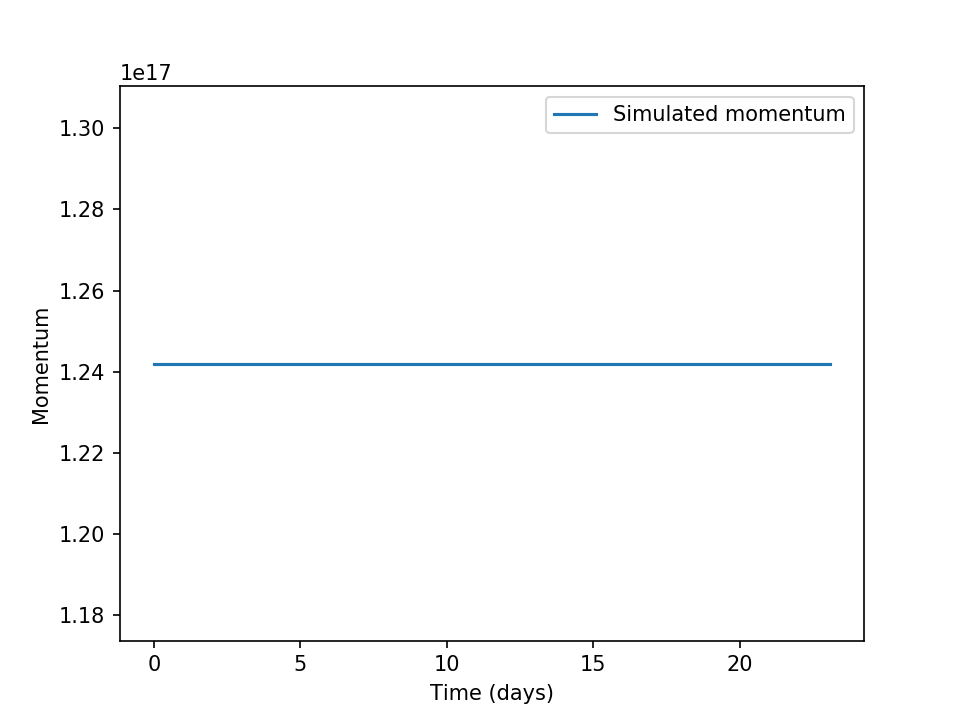

Verification
************************

Aronnax includes a number of diagnostic test to verify that the numerical core is satisfactorily solving the equations of motion.

Conservation of volume
========================

The test suite checks for volume conservation on each of the test simulations. The extent to which volume is conserved depends on the numerical accuracy of your simulation: large timesteps and coarse grids will reduce the accuracy of the simulation, and hence may affect volume conservation. Additionally, the use of sponge regions can affect both global and layerwise volume conservation, depending on the configuration. :numref:`tab_volume_conservation` shows when global or layerwise volume conservation can be expected.

.. table:: When to expect volume conservation
    :name: tab_volume_conservation

    +------------------+-----------------+----------------------+
    | Physics          | Sponge regions? | Volume conservation  |
    +------------------+-----------------+----------+-----------+
    |                  |                 |  Global  | Layerwise |
    +==================+=================+==========+===========+
    | n-layer          |       Yes       |  Yes     | No        |
    +------------------+-----------------+----------+-----------+
    | n-layer          |       No        |  Yes     | Yes       |
    +------------------+-----------------+----------+-----------+
    | n + 1/2 layer    |       Yes       |  No      | No        |
    +------------------+-----------------+----------+-----------+
    | n + 1/2 layer    |       No        |  Yes     | Yes       |
    +------------------+-----------------+----------+-----------+

Momentum forcing
==========================

The verification suite runs an ensemble of simulations with different horizontal resolutions to assess the impact of resolution on the treatment of momentum within the model. These simulations are started from rest and a single grid point in the centre of the doubly periodic domain is subjected to a small wind forcing. The model is then integrated forward in time with all explicit viscosity and drag parameters set to zero. The difference between the simulated momentum and the expected momentum provides a measure of how well the model treats momentum.

All of the simulations are integrated for one model year using the same value for :math:`\delta t`. This prevents variation due integrating for different amounts of model time or using different timesteps.

Reduced gravity mode
+++++++++++++++++++++++++++++++++

The figures in this subsection use the absolute-value momentum metric described under the n-layer mode below, so they overstate the true momentum error. The magnitude of the error varies with :math:`\delta x`, suggesting it is likely due to truncation error - the error induced by solving a continuous set of equations on a discrete grid.

   Momentum error as a function grid size for simulations using the reduced gravity mode.

The evolution of momentum in the 8 km resolution test simulation using reduced gravity physics.

   Momentum evolution as a function of time at 8 km resolution in the reduced gravity configuration. The two lines are indistinguishable.

n-layer mode
+++++++++++++++++++++++++++++++++
Earlier versions of this verification summed the absolute value of the momentum in every grid cell. That quantity is not momentum: it also counts the momentum carried away from the forcing point by radiated gravity waves. The barotropic gravity waves of the n-layer mode are much faster than the internal waves of the reduced gravity mode, so the metric exaggerated the n-layer "error" and gave it a different dependence on :math:`\delta x` (`issue #100 <https://github.com/edoddridge/aronnax/issues/100>`_).

The signed momentum summed over all layers and over a doubly periodic domain obeys :math:`dM/dt = F + f\,\hat{k}\times M`, where :math:`F` is the total wind force, because pressure forces and the transfer of momentum between layers integrate to zero. This has a closed-form solution, and :code:`test/physics_test.py` compares the model with it, in the automated test suite, for 1, 2, 3 and 4 layers at three horizontal resolutions (20, 10 and 5 km). Without rotation the n-layer mode reproduces the expected momentum to better than 1 part in :math:`10^{7}`. With rotation the relative error is about :math:`3\times10^{-5}` and does not depend on the number of layers or on :math:`\delta x`; it is the time-truncation error of the Coriolis term.

The momentum evolution figures that were previously shown here used the absolute-value metric and have been removed.

Momentum convservation
======================

The verification suite also runs simulations to assess how well the model conserves momentum. Once again all explicit drag parameters have been set to zero. The Coriolis parameter has also been set to zero to remove inertial oscillations and allow for a cleaner test.

In both the n-layer and reduced gravity modes the model conseres the initial momentum, as shown in :numref:`fig_n_layer_init_u_momentum` and :numref:`fig_red_grav_init_u_momentum`. The automated tests in :code:`test/physics_test.py` check this for 1 to 4 layers, in both modes, and find the signed momentum is conserved to round-off.

.. figure:: ../test/physics_tests/f_plane_n_layer_init_u/f_plane_momentum_test.png
   :alt: momentum time series from an unforced n-layer simulation
   :name: fig_n_layer_init_u_momentum

   A time series of momentum from an unforced n-layer simulation with non-zero initial conditions.

   A time series of momentum from an unforced reduced gravity simulation with non-zero initial conditions.
