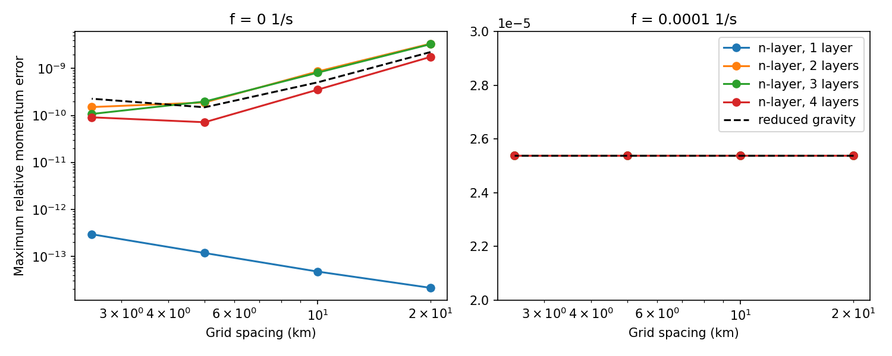
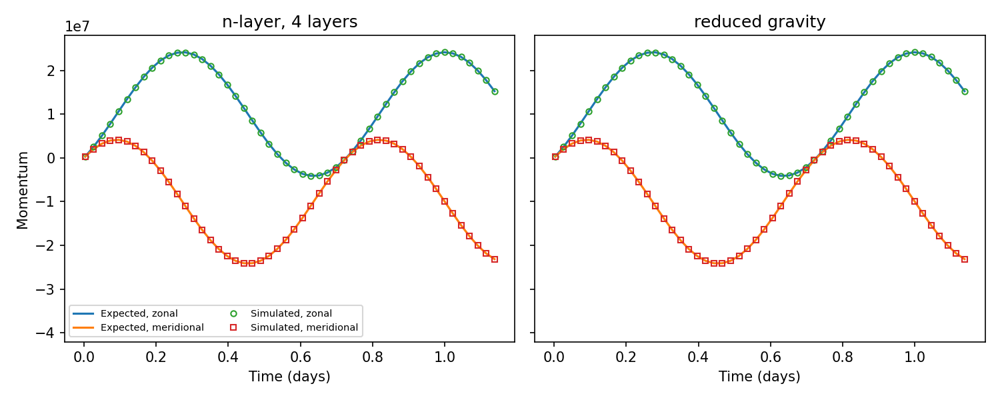
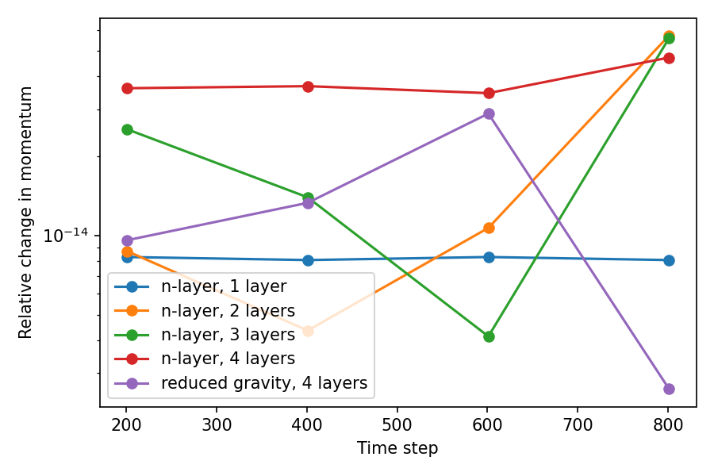

Verification
************************

Aronnax includes a number of diagnostic test to verify that the numerical core is satisfactorily solving the equations of motion.

Conservation of volume
========================

The test suite checks for volume conservation on each of the test simulations. The extent to which volume is conserved depends on the numerical accuracy of your simulation: large timesteps and coarse grids will reduce the accuracy of the simulation, and hence may affect volume conservation. Additionally, the use of sponge regions can affect both global and layerwise volume conservation, depending on the configuration. :numref:`tab_volume_conservation` shows when global or layerwise volume conservation can be expected.

.. table:: When to expect volume conservation
    :name: tab_volume_conservation

    +------------------+-----------------+----------------------+
    | Physics          | Sponge regions? | Volume conservation  |
    +------------------+-----------------+----------+-----------+
    |                  |                 |  Global  | Layerwise |
    +==================+=================+==========+===========+
    | n-layer          |       Yes       |  Yes     | No        |
    +------------------+-----------------+----------+-----------+
    | n-layer          |       No        |  Yes     | Yes       |
    +------------------+-----------------+----------+-----------+
    | n + 1/2 layer    |       Yes       |  No      | No        |
    +------------------+-----------------+----------+-----------+
    | n + 1/2 layer    |       No        |  Yes     | Yes       |
    +------------------+-----------------+----------+-----------+

Momentum forcing
==========================

A single grid point in the centre of a doubly periodic domain, initially at rest, is subjected to a small wind forcing in both horizontal directions, with all explicit viscosity and drag parameters set to zero. The signed momentum summed over all layers and over the domain obeys :math:`dM/dt = F + f\,\hat{k}\times M`, where :math:`F` is the total wind force, because pressure forces and the transfer of momentum between layers integrate to zero. This has a closed-form solution, and :code:`test/physics_test.py` compares the model with it as part of the automated test suite. The tests use 1, 2, 3 and 4 layers, horizontal grid spacings of 20, 10 and 5 km, and Coriolis parameters of zero and :math:`10^{-4}` s\ :sup:`-1`. The reduced gravity mode is also tested. The figures below are generated by :code:`docs/make_verification_figures.py`, which additionally includes a grid spacing of 2.5 km.

Without rotation the model reproduces the expected momentum to better than 1 part in :math:`10^{7}` in every configuration. With rotation the relative error is about :math:`2.5\times10^{-5}`, and it is the same for every number of layers, for both modes and for every grid spacing.

   Maximum relative difference between the simulated and expected momentum as a function of grid spacing, without rotation (left) and with rotation (right).

   Expected and simulated zonal and meridional momentum with rotation at 10 km resolution, for four layers (left) and reduced gravity (right).

Momentum convservation
======================

The verification suite also runs simulations to assess how well the model conserves momentum. Once again all explicit drag parameters have been set to zero. The Coriolis parameter has also been set to zero to remove inertial oscillations and allow for a cleaner test.

In both the n-layer and reduced gravity modes the model conseres the initial momentum, as shown in :numref:`fig_init_u_momentum`. The automated tests in :code:`test/physics_test.py` check this for 1 to 4 layers, in both modes, and find the signed momentum is conserved to round-off.

   Relative change in the signed momentum from the initial value in unforced simulations with a Gaussian initial zonal flow in the top layer, for the n-layer mode with 1 to 4 layers and for reduced gravity with 4 layers.
